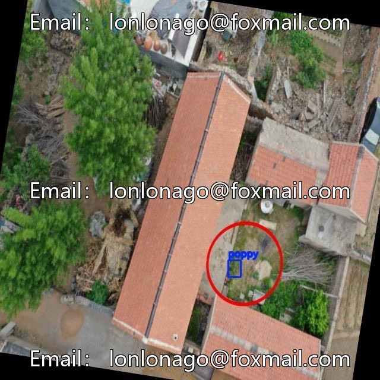
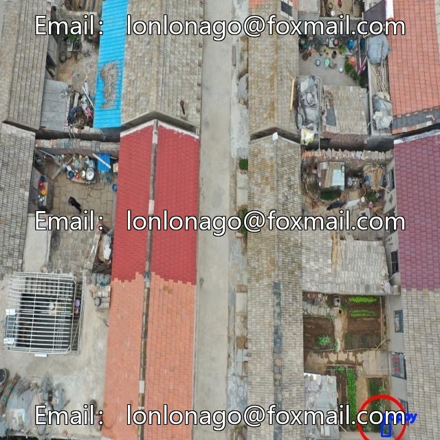
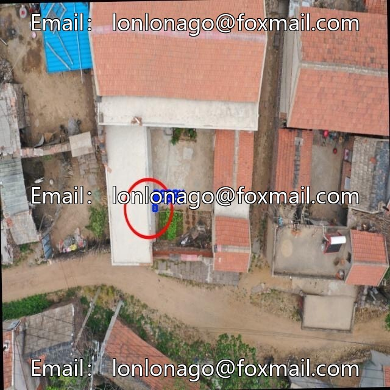
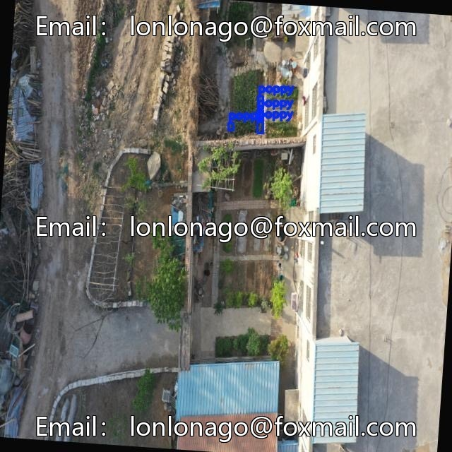
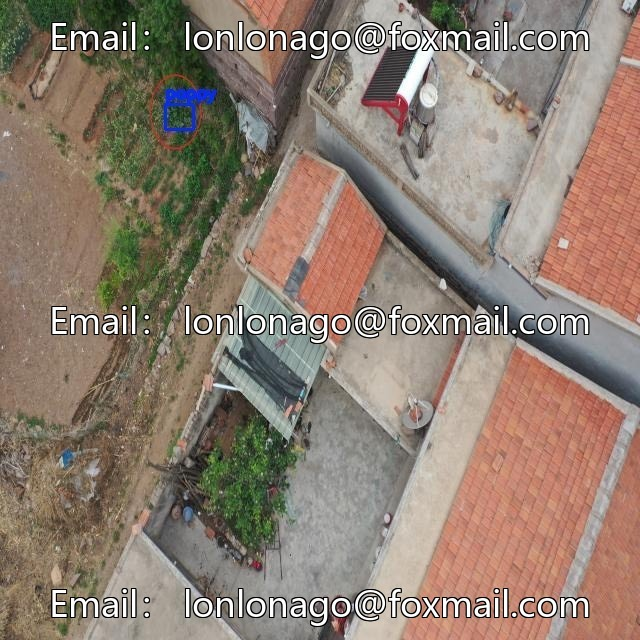

# Drone poppy identification dataset, 1400 images, all poppies (different growth stages)

## Body

Drone poppy identification dataset, 1400 images, all poppies (different growth stages and occlusion states), supports Yolo and VOC formats, suitable for drug raw plant monitoring, agricultural illegal cultivation investigation, ecological survey, etc.

The dataset is authentically collected, covering complex backgrounds such as mountains, farmlands, and shrubbery, with rigorous annotation, suitable for algorithm research and model training.

Virtual materials, once sold, are non-refundable.
Interested friends, click "I want" to proceed.

## Images

## Payment

Here is a pay link on Stripe ( https://buy.stripe.com/3cs8yP7sY87d0vu9AB ). Please contact me lonlonago@foxmail.com after funding $89, and I will send you a complete data files , thank you!

